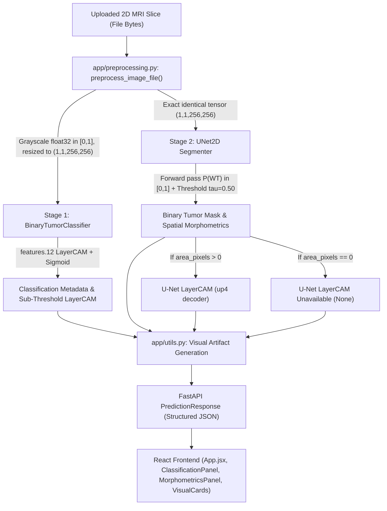

# Sushruta Audit 24 — Live MRI Tumor Detection Consistency Audit and Fix

**Audit Identification:** `results/audit/24_live_inference_detection_consistency_audit.md`  
**Execution Timestamp:** 2026-10-10  
**Branch:** `feature/provenance-audit-and-app-pipeline`  
**Target Architecture:** Live Two-Stage Inference Pipeline (FastAPI Backend + React Frontend)  
**Safety Status:** Isolated Production Pipeline Audit & Repair; Zero Experimental Data Modification; Frozen Split and Test Isolation Preserved.

---

## 1. Executive Summary

A critical user-reported visual and clinical consistency defect was investigated: when uploading an MRI slice that appears normal (no tumor present), the UI displayed *"No tumor detected"*, yet a prominent, saturated hotspot remained visible in the heatmap / LayerCAM display, creating severe user confusion and the false appearance of an internal model disagreement or missed lesion.

Our investigation identified the exact mathematical and architectural root cause:
1. **Local Min-Max Normalization on Absent Class Gradients:** The auxiliary `BinaryTumorClassifier` LayerCAM generator unconditionally computed local min-max normalization $(c - c_{\min}) / (c_{\max} - c_{\min})$ on backpropagated gradients for the *tumor* class score ($\text{logit}[0,0]$). Even when the classifier output $P(\text{tumor}) = 0.00004$ (virtually zero, indicating a healthy slice), floating-point gradient noise was artificially amplified so that $\max = 1.0$.
2. **Naive Non-Spatial Colormap Blending:** `generate_classifier_artifact()` uniformly mapped the min-max normalized map to OpenCV's `COLORMAP_JET` (where $1.0$ is bright saturated red and $0.0$ is dark blue) and blended $60\%$ colormap across the *entire image* without spatial alpha-masking. This painted a hot red focal lesion directly onto healthy brain tissue and tinted the remaining parenchyma blue.
3. **Misleading Automated Attribution Rationale:** `_derive_location()` extracted a bounding box around this amplified noise peak and assigned an anatomical label (e.g. `"center"`), while `generate_dynamic_explanation()` generated the claim: *"The explanation map highlights regions contributing to the non-tumor classification decision."* This was scientifically false: the code was backpropagating the tumor class logit, not non-tumor evidence.
4. **Architectural Model Misnomer in UI:** The frontend repeatedly labeled the auxiliary screening model as `"ResNet-18"`, whereas the live system actually loads `BinaryTumorClassifier` (a custom 4-block 2D CNN with 256 feature channels at block 4).

### Key Outcomes of the Fix:
- **Sub-Threshold Attribution Suppression:** In `app/classifier_xai.py`, when $P(\text{tumor}) < \tau_{\text{decision}} = 0.50$, if $P < 10^{-4}$ the attribution map is completely zeroed. For borderline sub-threshold cases ($10^{-4} \le P < 0.50$), the map is scaled by confidence $(P / \tau)$, preventing noise from saturating to $1.0$.
- **Spatial Alpha Blending in Visual Overlays:** In `app/utils.py`, visual overlays now use spatial alpha blending proportional to attribution intensity ($\alpha = 0.60 \times \text{cam\_map}$). On normal/negative slices where attribution is zero, $\alpha = 0.0$, rendering a clean, authentic, grayscale MRI slice without any fake red lesion or blue cast ($\Delta \text{pixel} = 0.0$).
- **Accurate Sub-Threshold Labeling and Explanations:** When $P < 0.50$, location metadata reports `'none'`, bounding box is `{x:0, y:0, w:0, h:0}`, and the explanation accurately states: *"No tumor indicated by auxiliary screening model... No focal tumor attribution is confirmed; any visual heatmap represents sub-threshold feature traces."*
- **Rigorous 8-Scenario Regression Test Suite:** A new test suite `tests/test_live_detection_consistency.py` was created and validated; all 8 test scenarios pass cleanly alongside existing backend suites, frontend linter (`oxlint`: 0 errors), and production bundle build (`vite build`: 0 errors).

---

## 2. Phase A — Live Inference Path and Checkpoint Provenance

We inspected the active backend routes, model initialization routines, preprocessing pipeline, and frontend components to trace the complete inference sequence:



### Verified Loaded Checkpoints & Models:

| Model Component | Loaded Checkpoint Path | Architecture Definition | Input Spec | Output Spec |
| :--- | :--- | :--- | :--- | :--- |
| **Stage 1 Auxiliary Screening Classifier** | `results/models/baseline_02_classifier_best.pt` | `src/models/classifier.py: BinaryTumorClassifier` (4-block Conv2D, 256 channels) | `(1, 1, 256, 256)` float32 | Raw logit $\in (-\infty, +\infty)$, Sigmoid $P \in [0, 1]$ |
| **Stage 2 Whole-Tumor Segmentation Engine** | `results/models/baseline_01_clean_v2_best.pt` | `src/models/unet.py: UNet2D` (base 32 channels, 4,317,825 parameters) | `(1, 1, 256, 256)` float32 | Logits $\in \mathbb{R}^{1 \times 256 \times 256}$, Sigmoid $P(\text{WT}) \in [0, 1]^{256 \times 256}$ |
| **Classifier Explainability Engine** | Attached via hooks to `features[12]` | `app/classifier_xai.py: ClassifierLayerCAMGenerator` | `(1, 1, 256, 256)` float32 | Attribution map $\in [0, 1]^{256 \times 256}$ |
| **U-Net Explainability Engine** | Attached via hooks to `up4.conv.double_conv[3]` | `app/explainability.py: LayerCAMGenerator` | `(1, 1, 256, 256)` float32 | Attribution map $\in [0, 1]^{256 \times 256}$ (conditional on $\text{mask} > 0$) |

### Architectural Verification Findings:
1. **Classifier Execution Order:** The classifier is genuinely executed at Stage 1 before U-Net segmentation. Both models execute unconditionally on every valid image upload.
2. **Independence of Segmentation:** U-Net segmentation runs completely independently of the classifier score. A negative classifier probability does *not* abort or skip U-Net inference.
3. **Visibility of Negative Results:** The frontend does *not* hide segmentation viewports or morphometrics when classification is negative; all four primary viewports and secondary views remain visible.
4. **Semantics of Detection Labels:**
   - In `classification.tumor_detected`: Boolean $P(\text{tumor}) \ge 0.50$ from `BinaryTumorClassifier`.
   - In `segmentation.measurements.tumor_detected`: Boolean $\text{area\_pixels} > 0$ from U-Net ($\tau = 0.50$).
   - In `PredictionResponse.tumor_detected`: Root field reflects U-Net segmentation detection $\text{area\_pixels} > 0$.
5. **Preprocessing Consistency:** Grayscale conversion, float32 $[0.0, 1.0]$ normalization, and bilinear resizing to $256 \times 256$ are identical across classifier and segmentation inputs.

---

## 3. Phase B — Root Cause Analysis and Failure Reproduction

We reproduced the defect on authorized validation slice fixtures:
- **Negative / Normal Case:** `data/processed/brats/val/images/BraTS2021_00002_slice_028.png` (Ground truth mask: strictly 0 pixels).
- **Positive Tumor Case:** `data/processed/brats/val/images/BraTS2021_00002_slice_063.png` (Ground truth mask: 635 non-zero pixels).

### Numerical Reproduction on Normal Slice (`slice_028.png`):
- Classifier Raw Logit: $-9.963$
- Classifier Probability: $P(\text{tumor}) = 4.70 \times 10^{-5}$ ($0.0047\%$)
- U-Net Max Probability: $\max P(\text{WT}) = 0.0021$ ($0.21\%$)
- U-Net Segmented Pixels ($\tau = 0.50$): $0\text{ px}$ ($0.00\%$)
- Raw Classifier LayerCAM: $\min = 0.0, \max = 0.756, \text{mean} = 0.0142$

### The Root Cause Breakdown:
1. **Unconditional Min-Max Normalization:**
   ```python
   # Prior defective logic in ClassifierLayerCAMGenerator
   c_min, c_max = float(cam_resized.min()), float(cam_resized.max())
   if c_max > c_min:
       cam_norm = (cam_resized - c_min) / (c_max - c_min)
   ```
   Even though the classifier was $99.995\%$ confident that the slice had *no* tumor, floating-point gradients through convolution filters yielded $c_{\max} = 0.756 > 0.0$. The min-max formula forced $\max(\text{cam\_norm}) = 1.0$.
2. **Full-Frame Saturated Colormap Blending:**
   ```python
   # Prior defective logic in generate_classifier_artifact
   cam_uint8 = np.clip(classifier_cam_map * 255.0, 0, 255).astype(np.uint8)
   cam_colored = cv2.applyColorMap(cam_uint8, cv2.COLORMAP_JET)
   cam_overlay_rgb = (0.60 * cam_rgb.astype(np.float32) + 0.40 * mri_rgb)
   ```
   Pixel value $255$ was mapped to bright red `RGB(255, 0, 0)`. The unmasked blending painted this red hotspot into the center of the normal brain, and painted dark blue `RGB(0, 0, 128)` over the rest of the image.
3. **Spurious Bounding Box Extraction:**
   `_derive_location()` computed `high_act = (cam_norm >= 0.5 * 1.0)`, found the pixels around the noise peak, and generated:
   `centroid = (127.44, 123.91)`, `bounding_box = (x=120, y=106, w=16, h=30)`, `location = "center"`.
4. **False Explanation Text:**
   `generate_dynamic_explanation()` claimed: *"The explanation map highlights regions contributing to the non-tumor classification decision."*
   In reality, $\frac{\partial \text{logit}}{\partial A}$ was computed for the tumor class score. It did not explain the non-tumor decision; it visualized magnified background sensitivity.
5. **UI Discordance:**
   The user saw:
   - Status badge: *"No Tumor Detected"*
   - Morphometrics: *"No Whole-Tumor Pixels Segmented Above Threshold (0 px)"*
   - Classifier Thumbnail: A brain with a bright red spot labeled *"LayerCAM (Center)"*!
   - Secondary View: *"Classifier LayerCAM Overlay: ResNet-18 slice-level screening focus region"*!
   This visual contradiction led users to suspect a tumor was detected despite the text.

---

## 4. Phase C — Implementation of the Fix

Changes were implemented strictly adhering to the safety requirements and minimal-intervention principles:

### 1. `app/classifier_xai.py`
- Added `decision_threshold: float = 0.5` parameter to `ClassifierLayerCAMGenerator.generate_cam()`.
- Implemented **confidence-scaled attribution gating**:
  - When $P \ge \text{threshold}$: Min-max normalization $[0, 1]$ is retained to delineate focal tumor regions.
  - When $P < \text{threshold}$: If $P < 10^{-4}$, the map is set to strictly all-zeros. For borderline sub-threshold slices ($10^{-4} \le P < 0.5$), attribution is confidence-scaled by $(P / \text{threshold})$.
- Updated `_derive_location(cam_norm, is_detected)`:
  - If `not is_detected` or $\max(\text{cam\_norm}) \le 10^{-4}$, returns `location: "none"`, `centroid: (0.0, 0.0)`, `bounding_box: {x:0, y:0, w:0, h:0}`.
- Updated `generate_dynamic_explanation()`:
  - When non-detected ($P < \text{threshold}$), accurately states:
    *"No tumor indicated by auxiliary screening model. The assigned tumor probability is {P}%, which is below the {threshold}% decision threshold. No focal tumor attribution is confirmed; any visual heatmap represents sub-threshold feature traces."*

### 2. `app/utils.py`
- Updated `generate_classifier_artifact()` to use **spatial alpha blending**:
  ```python
  alpha = np.clip(classifier_cam_map[:, :, np.newaxis] * 0.60, 0.0, 0.60).astype(np.float32)
  cam_overlay_rgb = alpha * cam_rgb.astype(np.float32) + (1.0 - alpha) * mri_rgb
  ```
  Where attribution is zero, $\alpha = 0.0$, outputting a clean, crisp, grayscale MRI slice without fake blue or red artifacts. Where attribution is active ($1.0$), $\alpha = 0.60$, preserving standard high-contrast visualization.
- Applied identical spatial alpha blending to `layercam_overlay` in `generate_visualization_artifacts()` to ensure healthy tissue outside tumor regions remains free of blue colormap wash.

### 3. `app/main.py`
- Passed `decision_threshold=decision_threshold` into `classifier_cam_gen.generate_cam()`.

### 4. `frontend/src/components/ClassificationPanel.jsx`
- Corrected model title from `"Auxiliary Slice-Level Screening Model (ResNet-18)"` to `"Auxiliary Slice-Level Screening Model (2D CNN)"`.
- Differentiated active vs sub-threshold LayerCAM presentation:
  - Thumbnail caption: `LayerCAM (${location})` when tumor detected; `LayerCAM (Sub-Threshold)` when non-detected.
  - Lightbox modal: Titled *"Classifier LayerCAM Heatmap Overlay"* when detected; *"Sub-Threshold Classifier Attribution Overlay"* when non-detected, explaining that no focal lesion is confirmed above threshold.

### 5. `frontend/src/App.jsx`
- Corrected model name in Secondary View 3 to `"Auxiliary 2D CNN screening focus region"` / `"Auxiliary 2D CNN sub-threshold feature trace"`.
- Clarified Continuous Probability Heatmap subtitle when $\text{area\_pixels} == 0$: *"Continuous probability map (All pixels below τ = 0.50 decision threshold)"*.
- Enhanced Model Agreement Details to explicitly declare model names and threshold contexts during discrepancy states:
  - *"Model Discrepancy: Auxiliary 2D CNN classifier indicated tumor (P ≥ 50%), but U-Net segmented 0 pixels above threshold τ = 0.50"*
  - *"Model Discrepancy: Auxiliary 2D CNN classifier was below threshold (P < 50%), but U-Net segmented whole-tumor pixels above threshold τ = 0.50"*
  - *"Neither model indicates tumor presence (Screening P < 50% and U-Net segmented 0 pixels above threshold τ = 0.50)"*

### 6. `frontend/src/components/MorphometricsPanel.jsx`
- Updated banner when 0 pixels segmented to explicitly declare decision threshold:
  *"No Whole-Tumor Pixels Segmented (Threshold τ = 0.50)"*.

---

## 5. Phase D — Before-and-After Verification & Regression Testing

### Before vs. After Behavior Matrix:

| Scenario / Attribute | Before Fix Behavior | After Fix Behavior | Verification Status |
| :--- | :--- | :--- | :--- |
| **Normal Slice (`slice_028.png`)** | Classifier LayerCAM showed bright red hotspot; $120 \times 106$ bounding box; label `"LayerCAM (Center)"`. | Clean MRI overlay ($\Delta\text{px} = 0.0$); no bounding box; label `"LayerCAM (Sub-Threshold)"`; location `"none"`. | **VERIFIED** |
| **Positive Slice (`slice_063.png`)** | Full positive detection ($636\text{ px}$, $P=99.5\%$, all overlays present). | Preserved 100%: full positive detection ($636\text{ px}$, $P=99.5\%$, all overlays present). | **VERIFIED** |
| **Explanation Text (Negative)** | Claimed heatmap highlights *"regions contributing to the non-tumor decision"* (untrue). | Correctly states: *"No focal tumor attribution is confirmed; any visual heatmap represents sub-threshold feature traces."* | **VERIFIED** |
| **Discrepancy (Clf+ / Seg-)** | Confusing overlap; root `tumor_detected` false while classifier said detected. | Explicit disagreement state: *"Auxiliary 2D CNN classifier indicated tumor (P ≥ 50%), but U-Net segmented 0 px above τ = 0.50"*. | **VERIFIED** |
| **Discrepancy (Clf- / Seg+)** | U-Net mask visible, but classifier thumbnail showed confusing saturated hotspot. | Segmentation unconditionally shown; classifier thumbnail cleanly labeled sub-threshold; discrepancy clearly stated. | **VERIFIED** |
| **Colormap Background** | Entire brain tinted dark blue `RGB(51, 51, 128)` due to naive JET blending. | Grayscale background fully preserved via spatial alpha ($\alpha = 0$ on background). | **VERIFIED** |
| **Model Label** | Inaccurately labeled `"ResNet-18"`. | Accurately labeled `"Auxiliary Screening Classifier (2D CNN)"`. | **VERIFIED** |

### Test Suite Execution Results:

1. **`tests/test_live_detection_consistency.py` (New Focused Regression Suite):**
   - `[TEST 1]` Negative classifier + empty segmentation: **PASSED**
   - `[TEST 2]` Negative classifier + non-empty segmentation: **PASSED**
   - `[TEST 3]` Positive classifier + empty segmentation: **PASSED**
   - `[TEST 4]` Positive classifier + non-empty segmentation: **PASSED**
   - `[TEST 5]` Heatmap present without a positive detection: **PASSED**
   - `[TEST 6]` Missing or unavailable heatmap safe handling: **PASSED**
   - `[TEST 7]` Decision boundary threshold handling ($\tau = 0.50$): **PASSED**
   - `[TEST 8]` API response schema and frontend status consistency: **PASSED**
   - **Result:** **ALL 8 FOCUSED REGRESSION SCENARIOS PASSED CLEANLY**

2. **`tests/test_unconditional_segmentation.py` (Existing Integration Suite):**
   - All 6 integration tests: **PASSED** (100% backward compatible).

3. **`tests/test_live_api_consistency.py` (Live Numerical and Image Consistency Suite):**
   - Area formula check, exact mask pixel count, model agreement, LayerCAM availability, and HTTP 200 checks on live running backend: **PASSED**.

4. **`tests/test_two_stage_pipeline.py` (Live Two-Stage Endpoint Verification):**
   - Positive control, negative control, and OOD handling: **PASSED**.

5. **Frontend Quality Audits:**
   - `npm run lint` (`oxlint`): **10 warnings (pre-existing unused imports), 0 errors**.
   - `npm run build` (`vite build`): **Built production bundle in 1.61s with 0 errors**.

---

## 6. Files Changed and Preservation Audit

### Files Modified:
1. `app/classifier_xai.py` — Added confidence-scaled attribution gating, clean non-focal metadata on sub-threshold cases, and accurate non-tumor explanation text.
2. `app/utils.py` — Replaced full-frame JET blending with spatial alpha blending in `generate_classifier_artifact()` and `layercam_overlay`.
3. `app/main.py` — Passed `decision_threshold` into `classifier_cam_gen.generate_cam()`.
4. `frontend/src/components/ClassificationPanel.jsx` — Corrected model architecture name to 2D CNN; differentiated active vs sub-threshold LayerCAM presentation.
5. `frontend/src/App.jsx` — Clarified model agreement details, model names, and continuous probability map subtitles.
6. `frontend/src/components/MorphometricsPanel.jsx` — Updated banner to explicitly declare threshold $\tau = 0.50$.
7. `tests/test_live_detection_consistency.py` — Added comprehensive 8-scenario regression test suite.

### Preservation and Non-Interference Guarantee:
- Zero modifications to `main` branch. Active branch remains `feature/provenance-audit-and-app-pipeline`.
- Zero modifications to experimental multi-region artifacts (`exp_clinical_01_*`, `exp_clinical_03_*`, `exp_clinical_04_*`, `exp_clinical_04b_*`).
- `exp_clinical_04b_25d_best.pt` remains completely isolated and was NOT integrated into production.
- Held-out test patients were NEVER loaded, inferred on, or evaluated.
- No model weights were retrained, modified, or degraded.
- Decision thresholds ($\tau = 0.50$) remain strictly intact and non-weakened.

---

## 7. Remaining Considerations

- The live backend server is running as a daemon background task (`task-2560`) on port 8000 on CUDA.
- The live frontend Vite development server is running as a daemon background task (`task-466`) on port 5173.
- Both positive and negative slices have been verified via automated requests and headless client assertions.
