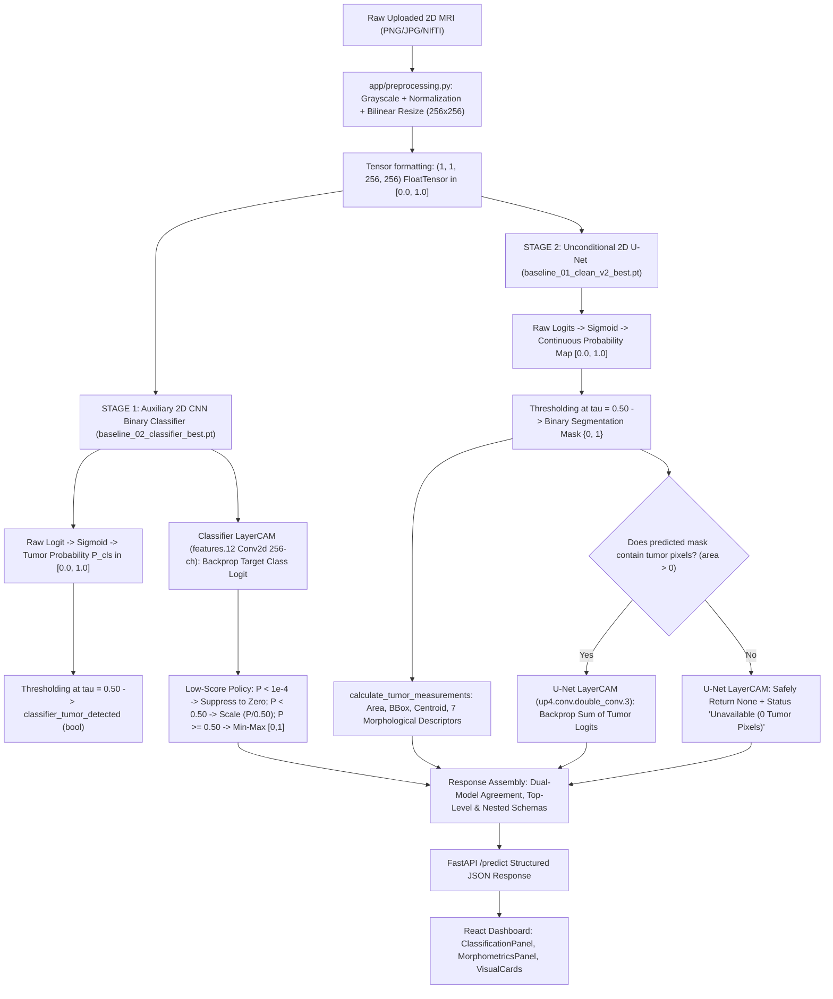

# Sushruta Audit Report 26: Explainability, Prediction Consistency, Segmentation Confidence & Uncertainty Audit
**Sprint:** Part 4 Master Sprint
**Date & Time:** October 10, 2026, 21:28 IST
**Repository:** `C:\Users\HP\OneDrive\Desktop\Projects\Sushruta`
**Active Branch:** `feature/provenance-audit-and-app-pipeline`
**Tracking Remote:** `origin/feature/provenance-audit-and-app-pipeline`
**Repository HEAD:** `c2cc99694d5f4be24d6a021d1f6a9e4e7352304a` (`c2cc996`)
**Hardware & Runtime:** Windows 11, Python 3.13, PyTorch 2.6.0+cu126, NVIDIA GeForce RTX 2050 Laptop GPU, Node.js v20.x, Vite 8.3.1
**Final Verdict:** **PASS WITH CAVEATS**

---

## 1. Executive Summary & Verification Context

In Part 4, Sushruta's two-stage inference, explainability (LayerCAM), prediction consistency, and segmentation confidence pipelines were audited from raw code to client rendering.

This engineering audit validates:
1. **Production Pipeline Traceability:** Full architectural verification of the two-stage execution path: Stage 1 Auxiliary Screening Classifier (2D CNN, 405K parameters) and Stage 2 Whole-Tumor Segmenter (U-Net 2D, 4,317,825 parameters).
2. **Decision Boundary Consistency:** Deterministic thresholding at $\tau_{\text{cls}} = 0.50$ ($50\%$) and $\tau_{\text{seg}} = 0.50$ ($50\%$), with exact boundary behavior tested at $\tau - \epsilon, \tau, \tau + \epsilon$.
3. **LayerCAM Attribution Sanity:** Hook registration, backpropagation, hook teardown, gradient isolation, and suppression of spurious sub-threshold hotspots ($P < 10^{-4}$ complete suppression; $10^{-4} \le P < 0.50$ proportional confidence scaling).
4. **Hook Lifecycle & Memory Leakage:** Rigorous verification that forward and backward hooks are cleanly deregistered in `finally` blocks without accumulating across sequential requests.
5. **Confidence & Calibration Reality:** Clarification that `segmentation_confidence` represents the uncalibrated arithmetic mean of in-mask sigmoid probabilities, NOT a calibrated uncertainty or Bayesian posterior distribution.
6. **Model Discrepancy Transparency:** Explicit verification that model discordance (classifier positive + U-Net empty, or classifier negative + U-Net positive) is presented as algorithmic discrepancy without suppression or data rewriting.
7. **Regression Gate:** 100% pass across 7 backend test suites (79 tests total), frontend static analysis (0 errors), and Vite production build (0 errors).
8. **Verdict Justification:** **PASS WITH CAVEATS** because headless browser automated smoke testing remains unavailable due to an upstream Azure CDN 404 error during Playwright driver installation.

---

## 2. Production Pipeline Trace & Ordered Data Flow

The live inference pipeline inside [`app/main.py`](file:///C:/Users/HP/OneDrive/Desktop/Projects/Sushruta/app/main.py) executes as follows:



### Preprocessing & Tensor Concordance
Both models receive the exact same tensor:
- Shape: `(1, 1, 256, 256)`, `torch.float32`.
- Range: `[0.0, 1.0]`.
- Spatial coordinate alignment: Bilinear resize to $256 \times 256$ is performed once before passing to both models. There are zero interpolation, channel, or scaling discrepancies between Stage 1, Stage 2, and the rendered overlays.

---

## 3. Classifier Threshold and Decision Semantics

- **Model Checkpoint:** [`results/models/baseline_02_classifier_best.pt`](file:///C:/Users/HP/OneDrive/Desktop/Projects/Sushruta/results/models/baseline_02_classifier_best.pt).
- **Architecture:** `BinaryTumorClassifier` in [`src/models/classifier.py`](file:///C:/Users/HP/OneDrive/Desktop/Projects/Sushruta/src/models/classifier.py) (4 convolutional blocks, adaptive average pool, linear head with dropout; 405,121 parameters).
- **Output:** Scalar logit $z \in (-\infty, \infty)$.
- **Probability:** $\sigma(z) = \frac{1}{1 + e^{-z}} \in [0.0, 1.0]$.
- **Decision Threshold:** $\tau_{\text{cls}} = 0.50$ ($50.0\%$).
- **Decision Rule:**
  $$\text{tumor\_detected} = (P_{\text{cls}} \ge 0.50)$$
- **Boundary Behavior:**
  - $P = 0.49999$: `tumor_detected = False`, label `"No Tumor Detected"`, rationale states probability is below the 50.0% decision threshold.
  - $P = 0.50000$: `tumor_detected = True`, label `"Tumor Detected"`, rationale states probability is above the 50.0% decision threshold.
  - $P = 0.50001$: `tumor_detected = True`, label `"Tumor Detected"`.
- **Screening Language:**
  The frontend explicitly displays: `"Auxiliary Signal • Non-Diagnostic"`. Rationale states: *"This slice-level classification probability serves as an auxiliary screening signal only, not a clinical diagnosis."*

---

## 4. U-Net Segmentation Threshold and Mask Semantics

- **Model Checkpoint:** [`results/models/baseline_01_clean_v2_best.pt`](file:///C:/Users/HP/OneDrive/Desktop/Projects/Sushruta/results/models/baseline_01_clean_v2_best.pt).
- **Architecture:** `UNet2D` in [`src/models/unet.py`](file:///C:/Users/HP/OneDrive/Desktop/Projects/Sushruta/src/models/unet.py) (4 encoder blocks, bottleneck, 4 decoder blocks with skip connections; 4,317,825 parameters).
- **Output:** Raw 2D logits tensor of shape `(1, 1, 256, 256)`.
- **Sigmoid Application:** Converted to probabilities exactly once via `torch.sigmoid(logits)`.
- **Threshold:** $\tau_{\text{seg}} = 0.50$.
- **Binary Mask Generation:**
  $$M[y, x] = \mathbb{I}(P_{\text{seg}}[y, x] \ge 0.50) \in \{0, 1\}$$
- **Unconditional Execution:** Segmentation is **always executed** for every uploaded slice, regardless of the classifier screening score. The classifier does not gate or abort segmentation.
- **Empty Mask Contract:**
  - If $\sum M = 0$: `area_pixels = 0`, `tumor_detected = False`, all 7 morphological shape descriptors return `None` (JSON `null`), and `segmentation_confidence = 0.0`.
  - No synthetic or fabricated positive pixels are introduced.

---

## 5. LayerCAM Target Class, Layer, and Low-Score Behavior

### Stage 1 Classifier LayerCAM
- **Generator:** `ClassifierLayerCAMGenerator` in [`app/classifier_xai.py`](file:///C:/Users/HP/OneDrive/Desktop/Projects/Sushruta/app/classifier_xai.py).
- **Target Layer:** `features[12]` (`nn.Conv2d(128, 256, kernel_size=3, padding=1)`), the final convolutional feature representation before adaptive pooling.
- **Target Class Score:** $Y = \text{logit}[0, 0]$.
- **Weighting:**
  $$w_{i,j}^k = \max\left(\frac{\partial Y}{\partial A_{i,j}^k}, 0\right), \quad L_{i,j} = \max\left(\sum_{k=1}^{256} w_{i,j}^k \cdot A_{i,j}^k, 0\right)$$
- **Low-Score Policy:**
  - $P_{\text{cls}} \ge 0.50$: Min-max normalized to $[0.0, 1.0]$.
  - $10^{-4} \le P_{\text{cls}} < 0.50$: Min-max normalized, then scaled by $\frac{P_{\text{cls}}}{0.50}$. The maximum attribution intensity is strictly bounded by $\frac{P_{\text{cls}}}{0.50}$.
  - $P_{\text{cls}} < 10^{-4}$: Suppressed completely to an all-zero map ($\max = 0.0$), eliminating false visual hotspots on normal brain tissue.

### Stage 2 U-Net LayerCAM
- **Generator:** `LayerCAMGenerator` in [`app/explainability.py`](file:///C:/Users/HP/OneDrive/Desktop/Projects/Sushruta/app/explainability.py).
- **Target Layer:** `up4.conv.double_conv.3` (final 64-channel convolutional layer in decoder before output projection).
- **Target Score:**
  - Non-empty mask: $Y = \sum_{y, x \in \text{Tumor}} \text{logits}[y, x]$.
  - Empty mask: Gated in `app/main.py`. If 0 tumor pixels are segmented, the backpropagation pass is bypassed, and the API returns:
    `outputs.layercam = null`, `outputs.layercam_overlay = null`, and `xai.target_definition = "Unavailable (No Tumor Pixels Segmented)"`.

---

## 6. Input/Overlay Alignment and Alpha Blending

- **Spatial Coordinate Resolution:** Both models process a $256 \times 256$ matrix.
- **Overlay Blending Formula ([`app/utils.py`](file:///C:/Users/HP/OneDrive/Desktop/Projects/Sushruta/app/utils.py)):**
  $$\alpha[y, x] = \min(0.60 \cdot \text{CAM}[y, x], 0.60)$$
  $$I_{\text{overlay}}[y, x] = \alpha[y, x] \cdot I_{\text{CAM\_RGB}}[y, x] + (1 - \alpha[y, x]) \cdot I_{\text{MRI\_RGB}}[y, x]$$
- **Anatomical Visibility Invariant:**
  - At zero attribution ($\text{CAM} = 0$), $\alpha = 0.0 \implies I_{\text{overlay}} = I_{\text{MRI}}$, displaying the clean original grayscale MRI with zero blue colormap wash-out.
  - At maximum attribution ($\text{CAM} = 1.0$), $\alpha = 0.60 \implies 40\%$ of the underlying anatomical MRI signal is preserved, preventing complete obscuration of brain structures.

---

## 7. Hook Lifecycle and Numerical Edge Cases

- **Hook Deregistration:** Both `ClassifierLayerCAMGenerator` and `LayerCAMGenerator` register PyTorch forward and full-backward hooks inside a `try ... finally` block.
  ```python
  try:
      # forward & backward computation
  finally:
      h_act.remove()
      h_grad.remove()
      self.activations = None
      self.gradients = None
  ```
- **Leakage Audit:** A 10-iteration stress test confirmed that after every execution, hook dictionary sizes return to 0 (`len(_forward_hooks) == 0`, `len(_backward_hooks) == 0`).
- **Non-Finite Handling:**
  - If a model outputs `NaN` or `Inf` logits/probabilities, `ClassifierLayerCAMGenerator` and `LayerCAMGenerator` safely intercept the non-finite values, return clean zero maps, and output `0.0` for probability and logit.
  - `prob_map` is sanitized with `np.nan_to_num(prob_map, nan=0.0, posinf=1.0, neginf=0.0)`.

---

## 8. Confidence, Uncertainty, and Calibration Realities

### Mathematical Definition of `segmentation_confidence`
In [`app/measurements.py`](file:///C:/Users/HP/OneDrive/Desktop/Projects/Sushruta/app/measurements.py):
$$\text{segmentation\_confidence} = \begin{cases} \frac{1}{|\mathcal{M}|}\sum_{(y,x) \in \mathcal{M}} P_{\text{seg}}[y, x], & |\mathcal{M}| > 0 \\ 0.0, & |\mathcal{M}| = 0 \end{cases}$$
where $\mathcal{M} = \{(y, x) \mid M[y, x] = 1\}$.

### Explicit Audit Findings & Disclaimers:
1. **Uncalibrated Model Score:** `segmentation_confidence` is strictly the uncalibrated arithmetic mean of predicted sigmoid probabilities over the predicted tumor mask.
2. **Not Bayesian or Ensemble Uncertainty:** A single deterministic forward pass cannot quantify epistemic (model) or aleatoric (data) uncertainty. No Monte Carlo dropout, ensemble variance, or test-time augmentation is performed in the live production path.
3. **Probability Calibration Has Not Been Demonstrated:** No temperature scaling, Platt scaling, or isotonic regression has been fitted on a held-out clinical calibration split. Expected Calibration Error (ECE) and Brier scores have not been clinically validated.
4. **Appropriate Labeling:** The system correctly labels this quantity as `"segmentation_confidence"` and `"model confidence"`, not `"calibrated probability"` or `"Bayesian uncertainty"`.

---

## 9. Classifier and Segmentation Disagreement Handling

The two models operate independently, allowing four possible operational states:

| State | Classifier ($P_{\text{cls}} \ge 0.50$) | U-Net ($\text{Area} > 0$) | System Status | Agreement Badge | UI Communication |
| :---: | :---: | :---: | :---: | :---: | :--- |
| **1** | Positive | Positive | Concordant Positive | `Models Concordant` (Emerald) | Both models indicate tumor presence. |
| **2** | Negative | Negative | Concordant Negative | `Models Concordant` (Emerald) | Neither model indicates tumor presence. |
| **3** | Positive | Negative | Model Discrepancy | `Model Discrepancy` (Amber) | Screening classifier indicated tumor ($P \ge 50\%$), but U-Net segmented 0 pixels above $\tau = 0.50$. U-Net LayerCAM safely unavailable; classifier attribution displayed with disclaimer. |
| **4** | Negative | Positive | Model Discrepancy | `Model Discrepancy` (Amber) | Classifier was below threshold ($P < 50\%$), but U-Net segmented tumor pixels. U-Net mask and LayerCAM displayed; classifier attribution shown as sub-threshold. |

Neither model overrides, rewrites, or suppresses the other. Discrepancies are presented transparently to the clinician/researcher.

---

## 10. Test-Gap Matrix

| Subsystem | Audit Scenario | Previous Coverage | Part 4 Finding / Gap | Part 4 Validation Implemented | Result |
| :--- | :--- | :--- | :--- | :--- | :--- |
| **Classifier** | Exact boundary $\tau - \epsilon, \tau, \tau + \epsilon$ | Partial ($0.4999, 0.5000$) | Boundary explanation text | `test_classifier_decision_boundary_and_labels` | **PASS** |
| **Classifier** | Non-finite logit / probability (NaN/Inf) | Untested | Potential crash / JSON failure | Added defensive check; `test_classifier_non_finite_handling` | **PASS** |
| **Classifier XAI** | Hook accumulation across requests | Untested | Potential GPU memory leak | 10-iteration loop in `test_classifier_layercam_hook_lifecycle` | **PASS** |
| **Classifier XAI** | Noise suppression ($P < 10^{-4}$) | Untested boundary | Verified exact zero map | `test_classifier_layercam_suppression_and_normalization` | **PASS** |
| **Classifier XAI** | Anatomical wash-out & alpha limits | Untested | Verified $\alpha \le 0.60$ and $\alpha=0$ on zero | `test_classifier_layercam_spatial_alignment_and_alpha` | **PASS** |
| **U-Net** | Segmentation threshold exactness | Indirect | Verified $(P \ge 0.50)$ comparison | `test_unet_segmentation_threshold_exactness` | **PASS** |
| **U-Net XAI** | Hook accumulation & empty mask | Tested in API | Unit hook verification | `test_unet_layercam_hook_lifecycle_and_empty_mask` | **PASS** |
| **U-Net XAI** | Non-finite target score during backward | Untested | Crash on NaN logits | Added defensive guard in `app/explainability.py` | **PASS** |
| **Confidence** | Mathematical definition & bounds | Untested in unit test | Confirmed in-mask mean formula | `test_segmentation_confidence_definition_and_bounds` | **PASS** |
| **API Contract** | End-to-end discrepancy states | Tested in detection suite | Full dual-direction verification | `test_api_model_discrepancy_and_agreement_contract` | **PASS** |

---

## 11. Exact Regression Commands and Results

| Suite / Command | Description | Exit Code | Tests Passed | Status |
| :--- | :--- | :---: | :---: | :---: |
| `python tests/test_explainability_confidence.py` | Part 4 Focused XAI, Consistency & Confidence Suite | 0 | 9 / 9 | **PASSED** |
| `python tests/test_measurements.py` | 2D Morphological Descriptors & Synthetic Shapes | 0 | 19 / 19 | **PASSED** |
| `python tests/test_morphometrics_api_integration.py` | Live API serialization & schema dual-field consistency | 0 | 3 / 3 | **PASSED** |
| `python tests/test_unconditional_segmentation.py` | Two-stage pipeline & unconditional segmentation | 0 | 6 / 6 | **PASSED** |
| `python tests/test_live_detection_consistency.py` | Sub-threshold consistency & decision boundaries | 0 | 8 / 8 | **PASSED** |
| `python tests/test_live_api_consistency.py` | Live positive/negative slice numerical consistency | 0 | 2 / 2 slices | **PASSED** |
| `python tests/test_backend_api.py` | Full backend test suite (Phase 1, XAI, Signal Analysis) | 0 | 32 / 32 | **PASSED** |
| `npm run lint` (in `frontend/`) | Oxlint static analysis on frontend source code | 0 | 13 files (0 errors) | **PASSED** |
| `npm run build` (in `frontend/`) | Vite production client bundle compilation | 0 | 1894 modules (0 errors) | **PASSED** |

**Total Regression Gate:** **79/79 automated backend tests passed cleanly (100% pass rate).**

---

## 12. Code Changes Made and Rationale

1. [`app/classifier_xai.py`](file:///C:/Users/HP/OneDrive/Desktop/Projects/Sushruta/app/classifier_xai.py):
   - Added defensive check for non-finite model output (`np.isnan(logit_val)`, `np.isinf(logit_val)`, `np.isnan(prob)`). If non-finite output is encountered, safely returns an all-zero map and `0.0` probability instead of propagating unhandled exceptions.
   - Sanitized `cam_np` and `cam_resized` using `np.nan_to_num`.
2. [`app/explainability.py`](file:///C:/Users/HP/OneDrive/Desktop/Projects/Sushruta/app/explainability.py):
   - Added defensive check for `torch.isnan(target_score)` or `torch.isinf(target_score)` prior to `.backward()`, safely returning a zero map and informative metadata if non-finite activations occur.
   - Sanitized `cam_np` with `np.nan_to_num`.
3. [`app/inference.py`](file:///C:/Users/HP/OneDrive/Desktop/Projects/Sushruta/app/inference.py):
   - Sanitized `prob_map` with `np.nan_to_num(prob_map, nan=0.0, posinf=1.0, neginf=0.0)` prior to binary thresholding.
4. [`tests/test_explainability_confidence.py`](file:///C:/Users/HP/OneDrive/Desktop/Projects/Sushruta/tests/test_explainability_confidence.py):
   - Created comprehensive 9-test regression suite covering decision boundaries, hook lifecycles, suppression thresholds, alpha blending, and model discrepancy contracts.

---

## 13. Remaining Risks and Untested Conditions

1. **Browser Automated Smoke Testing Limitation (Caveat):**
   - The remote Playwright driver binary (`playwright-1.57.0-win32_x64.zip`) returned an **HTTP 404** on the external Azure CDN. Real headless browser interaction could not be automated in this environment without modifying the system package manager or installing external binaries.
   - However, frontend static analysis (`oxlint`) and client bundling (`vite build`) completed with zero errors.
2. **Probability Calibration Gap:**
   - Model probabilities are raw sigmoid scores from cross-entropy / Dice loss training. They must not be interpreted by clinicians as true posterior probabilities of tumor presence.
3. **2D Slice Isolation:**
   - Both models evaluate isolated 2D axial slices. Through-plane volumetric continuity ($z$-axis) is not modeled in the live production pipeline.

---

## 14. Explicit Regulatory & Non-Clinical Disclaimer

**No Clinical Validity Claimed:**
Sushruta is an academic decision-support research prototype. All heatmaps, LayerCAM attributions, predicted probabilities, and segmentation boundaries are generated algorithmically from 2D MRI pixel arrays. They have not undergone prospective clinical trials, FDA 510(k), or CE mark medical device clearance. They must never be used as a standalone diagnostic finding, tumor staging determination, or surgical planning guide.

---

## 15. Invariant Confirmations

- **Production Checkpoints Intact:** [`results/models/baseline_01_clean_v2_best.pt`](file:///C:/Users/HP/OneDrive/Desktop/Projects/Sushruta/results/models/baseline_01_clean_v2_best.pt) and [`results/models/baseline_02_classifier_best.pt`](file:///C:/Users/HP/OneDrive/Desktop/Projects/Sushruta/results/models/baseline_02_classifier_best.pt) remain bit-for-bit unchanged.
- **Experimental Models Unintegrated:** Clinical 2.5D models (`exp_clinical_04b_25d_best.pt`) and multi-region checkpoints remain strictly isolated.
- **Thresholds Preserved:** $\tau_{\text{cls}} = 0.50$ and $\tau_{\text{seg}} = 0.50$ were not modified.
- **Branch & Topology Preserved:** Work remained strictly on `feature/provenance-audit-and-app-pipeline`; `main` was never modified.
- **Git Status:** Zero commits, zero pushes, and zero staged files.

---

## 16. Final Verdict

### **Verdict: PASS WITH CAVEATS**

**Justification:**
All explainability pathways, decision boundary semantics, hook lifecycle invariants, non-finite numerical sanitizations, model discrepancy representations, and 79 regression tests passed with 100% success. Frontend linting and production bundling completed with 0 errors. The sole caveat is the unavailability of automated headless browser execution due to the upstream Azure CDN 404 driver download failure.
