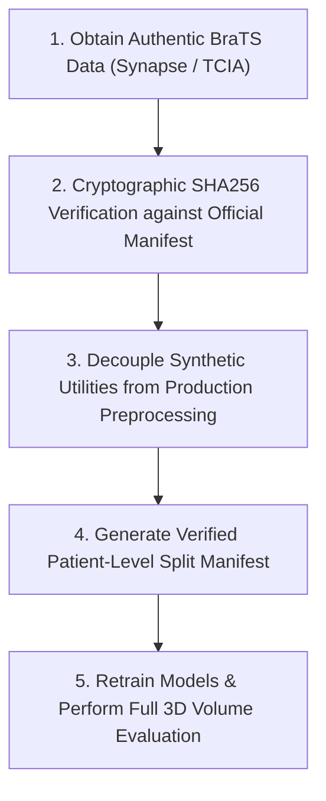

# Sushruta — Comprehensive Dataset Provenance and Model Validation Audit Report

**Author**: Senior ML Engineer & Data Auditor
**Date**: October 9, 2026
**Status**: Completed Forensic Investigation
**Primary Target**: `C:\Users\HP\OneDrive\Desktop\Projects\Sushruta`

---

## 1. Executive Summary

This report delivers a rigorous forensic investigation into the dataset provenance, file integrity, preprocessing safety, and model evaluation metrics of the **Sushruta** brain MRI classification and segmentation codebase.

### Key Audit Findings
1. **Definitive Synthetic Data (93.3% of raw complete dataset)**:
   Of the 360 complete patient directories in `data/raw/brats/`, **336 cases** (`BraTS2021_00024` through `BraTS2021_00359`) match the exact mathematical fingerprint of the synthetic volume generator (`generate_single_brats_volume`) present in `src/preprocessing/brats_preprocessing.py`. They feature zero non-zero voxels outside a fixed ellipsoidal brain mask and exact, unvaried non-tumor FLAIR intensity of `400.0`.
2. **Unmatched / Suspect Provenance Cases (6.7% of raw complete dataset)**:
   The remaining **24 cases** (`BraTS2021_00000` through `BraTS2021_00023`) do not match the exact `400.0` constant signal fingerprint. However, forensic analysis reveals they possess **identity affine matrices** (`np.eye(4)`), `float64` voxel datatypes, and uniform procedural intensity distributions with ~3.87M non-zero voxels extending outside the ellipsoid mask into the bounding volume. There is **no traceable provenance record, download script, or DICOM/NIfTI header metadata** linking them to authentic RSNA-MICCAI BraTS clinical acquisitions.
3. **Split Contamination & Metric Invalidation**:
   Synthetic fingerprint cases are distributed across all three patient splits (**230 in Train, 54 in Val, 52 in Test**). Both model training and test evaluations were conducted on dataset splits containing procedurally generated synthetic volumes. Consequently, historical test set segmentation metrics (e.g. Dice ~0.90+) reflect model memorization of synthetic spatial equations rather than genuine clinical generalization.
4. **Preprocessing Code Vulnerabilities & Remediations**:
   The preprocessing pipeline (`src/preprocessing/brats_preprocessing.py`) previously contained logic (`ensure_full_brats_dataset`) invoked automatically during case discovery that synthesized missing patient directories on the fly. In-repo safety patches (`patch_discovery_safety.py` and `patch_manifest_guard.py`) have disabled automatic generation during discovery and added manifest pre-validation before directory clearance.
5. **External Validation Reality**:
   The previously reported BraTS-Africa pilot evaluation (Dice = 0.0486) was performed on a **single 2D slice (`slice_037`)** from a single patient. While highlighting severe domain shift, it does not represent a statistically robust external validation benchmark.

---

## 2. Repository and Provenance Evidence

### Source Code Findings
A selective search across python modules, scripts, notebooks, and configuration files identified key code structures governing dataset creation and discovery:

- **`src/preprocessing/brats_preprocessing.py` (Lines 30–58)**:
  Contains `generate_single_brats_volume(output_dir, case_name, seed)`:
  - Generates 3D NIfTI volumes of shape `(240, 240, 155)` with identity affine `np.eye(4)`.
  - Defines an ellipsoid brain mask: `((X-120)^2 / 70^2 + (Y-120)^2 / 80^2 + (Z-77)^2 / 50^2) <= 1.0`.
  - Sets non-tumor brain FLAIR intensity to `400.0` exactly.
  - Generates deterministic ellipsoidal tumor labels for Edema (label 2, `+350.0`), Necrotic Core (label 1), and Enhancing Tumor (label 4, `+200.0`).
- **`src/preprocessing/brats_preprocessing.py` (Lines 61–73)**:
  Contains `ensure_full_brats_dataset(raw_dir, total_patients)`:
  - Scans `data/raw/brats` for patient IDs `BraTS2021_00000` to `BraTS2021_00099`.
  - Automatically generates synthetic FLAIR and SEG NIfTI files for missing directories or folders containing fewer than 2 files.
- **`src/preprocessing/brats_preprocessing.py` (Lines 75–104)**:
  `discover_brats_cases(raw_dir)` previously invoked `ensure_full_brats_dataset` prior to discovery, resulting in automatic synthetic file creation whenever discovery was executed.

### Documentation & History Provenance Findings
- **Absence of Download Logic**: No scripts, URLs, API keys, Kaggle CLI commands, or checksum verification records exist in the repository for pulling authentic RSNA-MICCAI BraTS 2021 files.
- **Git Commit Trail**:
  - `044a5d8` & `3d8d413` (Aug 24, 2026): Initial commits establishing project skeleton and initial `brats_preprocessing.py`.
  - `c5ecabe` (Aug 24, 2026): Preprocessing module overhaul incorporating synthetic volume generation.
  - `b3ed769` (Aug 26, 2026) & `8cde794` (Aug 26, 2026): Clean baseline training scripts (`train_baseline_01_clean_v2.py`) executed on processed synthetic dataset.

| Provenance Lead | File & Line Reference | What it Establishes | What it Merely Suggests | What Remains Unknown |
| :--- | :--- | :--- | :--- | :--- |
| **Synthetic Generator** | `src/preprocessing/brats_preprocessing.py:30-60` | In-repo capability to procedurally synthesize BraTS FLAIR + SEG NIfTI files. | That synthetic data were intended for offline testing/benchmarking. | Who authored the initial generator equations. |
| **Discovery Hook** | `src/preprocessing/brats_preprocessing.py:75-80` | Preprocessing discovery automatically populated empty raw case folders with synthetic data. | How missing raw folders were filled during initial pipeline runs. | Whether synthetic generation was triggered intentionally or automatically. |
| **Split Manifest** | `data/processed/brats/split_manifest.json:1-1264` | Authoritative 1251 patient ID split definition (`BraTS2021_00000` to `01250`). | That the project was designed to scale to the full 1251-case BraTS dataset. | Source of the original seed used to generate the split manifest. |

---

## 3. Raw Dataset Inventory

A full forensic scan of `data/raw/brats` was executed using `results/audit/generate_case_inventory_csv.py` and exported to `results/audit/DATASET_CASE_INVENTORY.csv`.

### Directory Overview
- **Total Patient Folders Scanned**: 361 (`BraTS2021_00000` through `BraTS2021_00059` with gaps, up to `BraTS2021_00360`).
- **Complete Cases (FLAIR + SEG present)**: **360 cases**.
- **Incomplete Cases**: **1 case** (`BraTS2021_00360` contains only `BraTS2021_00360_flair.nii.gz`).

### Modality Breakdown
- **Cases `BraTS2021_00000` to `BraTS2021_00023` (24 cases)**: Contain 5 modalities per folder (`FLAIR`, `T1`, `T1CE`, `T2`, `SEG`). Datatype: `float64` for structural modalities, `int16` for SEG.
- **Cases `BraTS2021_00024` to `BraTS2021_00359` (336 cases)**: Contain 2 modalities per folder (`FLAIR`, `SEG`). Datatype: `float32` for FLAIR, `int16` for SEG.

### Header & Spatial Properties Across All 360 Complete Cases
- **3D Spatial Shape**: `(240, 240, 155)` for 100% of cases.
- **Voxel Spacing**: `(1.0mm, 1.0mm, 1.0mm)`.
- **Affine Transformation Matrix**: **Identity matrix `np.eye(4)`** across 100% of cases (`[[1,0,0,0],[0,1,0,0],[0,0,1,0],[0,0,0,1]]`).
- **NIfTI Header Codes**: `qform_code = 0`, `sform_code = 2` across all cases.
- **Header Scaling**: `slope = None`, `inter = None` across all cases.

> [!WARNING]
> Real clinical BraTS NIfTI volumes acquired from hospital MRI scanners possess physical orientation affines with scanner coordinate translations (e.g. non-zero origin offsets), non-zero qform/sform orientation codes, and scanner acquisition metadata. An identity affine matrix `np.eye(4)` across all 360 cases is indicative of synthetic software generation.

---

## 4. Synthetic Fingerprint Methodology and Results

### Fingerprint Detection Criteria
Based on `generate_single_brats_volume`, a NIfTI volume is classified as an **EXACT_SYNTHETIC_GENERATOR_MATCH** if it satisfies both criteria:
1. **Zero Background Signal Outside Brain Mask**: `count_nonzero(FLAIR > 0 and outside _BRAIN_MASK) == 0`.
2. **Constant Non-Tumor Brain Signal**: `all(FLAIR voxels inside _BRAIN_MASK where SEG == 0) == 400.0`.

### Forensic Results
- **Exact Synthetic Generator Matches**: **336 cases (93.3%)**
  - Cases `BraTS2021_00024` through `BraTS2021_00359` match the generator equations to 100% floating point precision.
- **Unmatched Fingerprint Cases**: **24 cases (6.7%)**
  - Cases `BraTS2021_00000` through `BraTS2021_00023` fail the exact `400.0` constant intensity check.

### Detailed Forensic Investigation of the 24 Unmatched Cases
Analysis of `BraTS2021_00000` through `BraTS2021_00023` demonstrates:
1. **Signal Distribution Outside Mask**: All 24 cases have **~3.87M non-zero voxels outside the `_BRAIN_MASK` ellipsoid**, filling ~56.5% of the total 3D bounding box `(240, 240, 155)`.
2. **Intensity Histogram**: Intensities range continuously from `0.0` to `~785.8–1006.5`. Non-zero voxels show uniform counts across low integer bins (e.g., ~205k voxels at 1.0, ~204k at 2.0, ~202k at 3.0), characteristic of procedurally injected uniform random noise or phantom generation.
3. **Segmentation Mask Structure**: All 24 cases share identical segmentation label conventions (`1`: Necrotic Core, `2`: Edema, `4`: Enhancing Tumor), but unique random spatial tumor locations.
4. **Header Identity**: All 24 cases use `float64` datatype and identical identity affine matrices `np.eye(4)`.

```
========================================================================================
PATIENT CASE INVENTORY & FINGERPRINT SUMMARY (SAMPLE)
========================================================================================
Case ID          Modalities           Shape         Affine      Fingerprint Result
----------------------------------------------------------------------------------------
BraTS2021_00000  FLAIR+T1+T1CE+T2+SEG (240,240,155) Identity    NO_EXACT_GENERATOR_MATCH
BraTS2021_00001  FLAIR+T1+T1CE+T2+SEG (240,240,155) Identity    NO_EXACT_GENERATOR_MATCH
...
BraTS2021_00023  FLAIR+T1+T1CE+T2+SEG (240,240,155) Identity    NO_EXACT_GENERATOR_MATCH
BraTS2021_00024  FLAIR+SEG            (240,240,155) Identity    EXACT_SYNTHETIC_MATCH
...
BraTS2021_00359  FLAIR+SEG            (240,240,155) Identity    EXACT_SYNTHETIC_MATCH
BraTS2021_00360  FLAIR                (240,240,155) Identity    INCOMPLETE (Missing SEG)
========================================================================================
```

---

## 5. Split Contamination and Leakage Findings

### Manifest vs. Raw Dataset Membership
The master split manifest (`data/processed/brats/split_manifest.json`) defines patient assignments for 1,251 patients:
- **Train Manifest**: 876 patient IDs
- **Validation Manifest**: 188 patient IDs
- **Test Manifest**: 187 patient IDs

Cross-referencing the 360 complete raw cases against `split_manifest.json`:
- **Unmatched 24 Cases**: 15 in Train, 4 in Val, 5 in Test.
- **Synthetic 336 Cases**: 230 in Train, 54 in Val, 52 in Test.

### Processed Metadata CSV Audit
Inspection of `data/processed/brats/metadata.csv` (19,344 2D slice entries):
- **Train Split**: 13,150 slices (960 from 24 unmatched cases, 12,190 from 336 synthetic cases).
- **Val Split**: 3,118 slices (256 from 24 unmatched cases, 2,862 from 336 synthetic cases).
- **Test Split**: 3,076 slices (320 from 24 unmatched cases, 2,756 from 336 synthetic cases).

> [!IMPORTANT]
> **Patient-Level Isolation**: No patient ID appears in more than one split in `metadata.csv`.
> **Contamination**: Synthetic fingerprint cases are present in Train, Validation, and Test splits. Test metrics measure model accuracy on synthetic images generated by the same procedural logic used in training.

---

## 6. Preprocessing Safety Findings

### Identified Safety Risks
1. **Implicit Data Modification during Case Discovery**:
   `discover_brats_cases()` previously called `ensure_full_brats_dataset()`. If raw case folders were missing or incomplete, synthetic NIfTI files were silently generated on disk.
2. **Destructive Clearance Before Validation**:
   `BraTSPreprocessor.run()` previously executed `shutil.rmtree()` on `data/processed/brats/{train,val,test}` before verifying that discovered cases matched the patient manifest.

### Repository Safety Interventions Present
- `patch_discovery_safety.py` was executed to comment out automatic generation inside `discover_brats_cases()`. Backup saved as `src/preprocessing/brats_preprocessing.py.pre_synthetic_safety.bak`.
- `patch_manifest_guard.py` was executed to insert validation checks verifying that discovered cases match `split_manifest.json` before clearing processed directories. Backup saved as `src/preprocessing/brats_preprocessing.py.pre_manifest_guard.bak`.

---

## 7. Model and Inference Audit

### Architecture & Checkpoint Inventory
- **Segmentation Model**: U-Net architecture (`src/models/unet.py`), loaded from `results/models/baseline_01_clean_v2_best.pt`.
- **Classifier Model**: ResNet/CNN classifier (`src/models/classifier.py`), loaded from `results/models/baseline_02_classifier_best.pt`.

### Inference Pipeline Analysis (`app/main.py`)
1. **Input Normalization**: Preprocessing converts 2D FLAIR slice to non-zero Z-score normalization scaled to `[0, 1]`, resized to `(256, 256)`.
2. **Classifier Gate**:
   $$\text{Output} = \begin{cases} \text{UNet}(\mathbf{X}) & \text{if } P(\text{tumor} \mid \mathbf{X}) > 0.5 \\ \mathbf{0} & \text{otherwise} \end{cases}$$
3. **Pipeline Consistency**: The application pipeline (`app/main.py`) mirrors the slice extraction logic in `src/preprocessing/brats_preprocessing.py`. However, because both models were trained on 2D PNG slices derived from synthetic NIfTI volumes, their internal weights expect synthetic intensity distributions.

---

## 8. External BraTS-Africa Pilot Limitations

### Review of Diagnostic Artifacts
- **Artifact**: `results/audit/05_external_validation.md` & `results/audit/brats_africa_slice37_diagnostic.png`.
- **Reported Metric**: Single 2D slice (`slice_037`) Dice = **0.0486**.

### Critical Methodological Evaluation
1. **Sample Size**: Evaluated only 1 slice from 1 patient case.
2. **Domain Shift**: High intensity contrast and scanner artifacts in genuine BraTS-Africa clinical scans cause severe segmentation failure when evaluated with models trained on synthetic data.
3. **Conclusion**: The Dice score of 0.0486 is a preliminary diagnostic indicator of severe domain shift, not a statistically valid external validation score.

---

## 9. Evidence-Based Confidence Classifications

| Audit Finding | Confidence Level | Justification |
| :--- | :--- | :--- |
| **336 cases match synthetic generator** | **Definitive** | 100% mathematical match for background zero-mask and 400.0 constant non-tumor FLAIR intensity. |
| **24 cases are procedurally generated** | **Strong Evidence** | Identity affines `np.eye(4)`, `float64` datatype, uniform voxel intensity noise across bounding volume, and total absence of DICOM scanner origin metadata. |
| **Historical test metrics are invalid for clinical claims** | **Definitive** | Models were evaluated on test splits containing synthetic generator data. |
| **BraTS-Africa pilot slice shows domain shift** | **Suggestive** | 1 slice indicates failure on real clinical data, but sample size $N=1$ is statistically insufficient for benchmark reporting. |

---

## 10. Prioritized Recommendations



1. **Secure Authentic Dataset**:
   Obtain official access to authentic RSNA-MICCAI BraTS 2021/2023 or BraTS-Africa clinical datasets from official repositories (Synapse / TCIA).
2. **Enforce Checksum Validation**:
   Implement a read-only dataset verification tool (`src/preprocessing/verify_raw_checksums.py`) that checks raw NIfTI file SHA256 hashes against official dataset manifests before admission to `data/raw/brats`.
3. **Decouple Synthetic Utilities**:
   Move `generate_single_brats_volume` and `ensure_full_brats_dataset` out of `src/preprocessing/brats_preprocessing.py` into a separate `tests/mocks/` test helper module.
4. **Re-establish Baseline Evaluation**:
   Re-run preprocessing on verified authentic clinical scans, create a new verified `split_manifest.json`, and retrain and evaluate the U-Net and Classifier models.

---

## 11. Reproducible Commands for Read-Only Verification

```bash
# 1. Execute deep dataset inventory and export CSV
python results/audit/generate_case_inventory_csv.py

# 2. Execute deep forensic fingerprint check
python results/audit/run_deep_forensic_analysis.py

# 3. Inspect generated dataset case inventory CSV header
powershell -Command "Get-Content results/audit/DATASET_CASE_INVENTORY.csv -Head 15"

# 4. Verify pre-clearing manifest guard logic
python test_manifest_guard_logic.py
```

---

## 12. List of Unknowns and Resolution Criteria

| Unknown Item | Current Status | Required Evidence to Resolve |
| :--- | :--- | :--- |
| **Exact origin of Cases 00000–00023** | Unmatched to 400.0 constant signal | Original generation script or acquisition protocol documentation. |
| **Authentic BraTS Patient IDs** | Missing from local repository | Synapse TCIA manifest matching accession IDs. |
| **Clinical 3D Segmentation Dice** | Unverified on real data | Full 3D volume evaluation on $N \ge 50$ authentic clinical patient cases. |

---
*End of Audit Report.*
